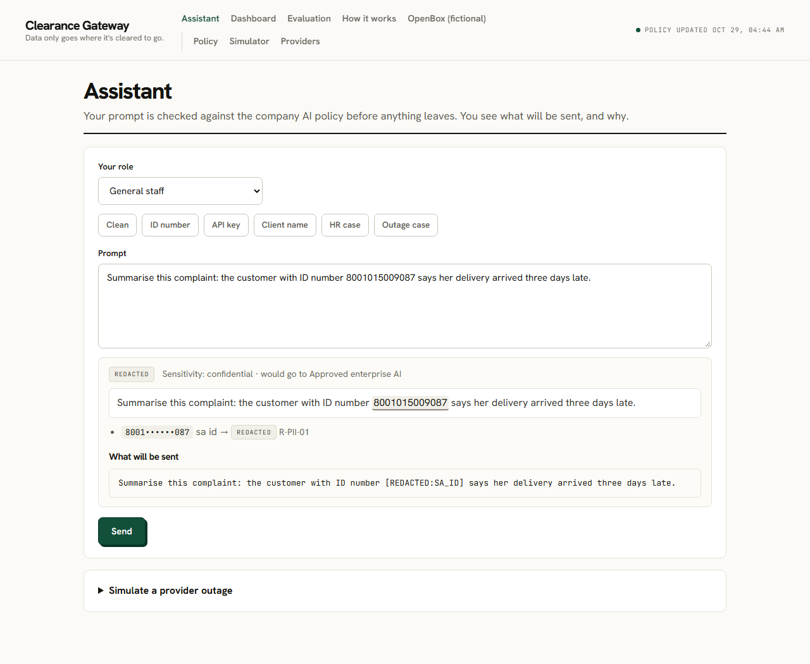
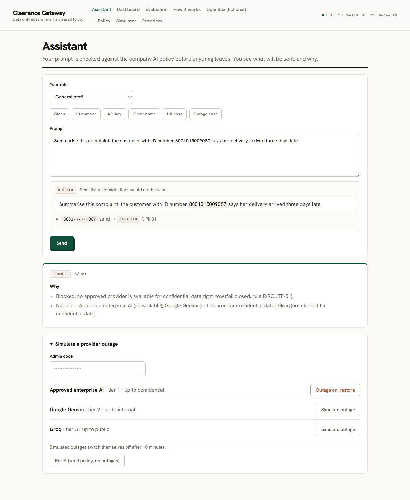
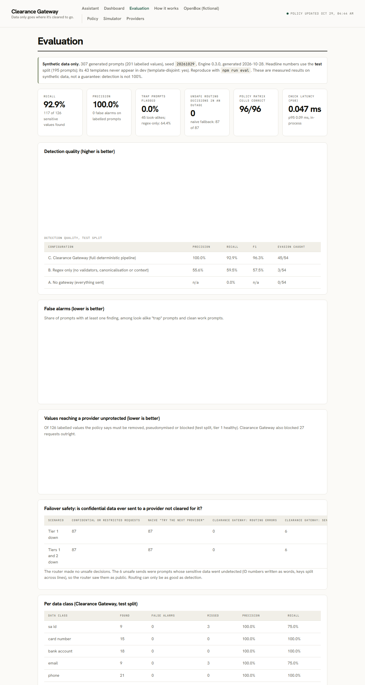
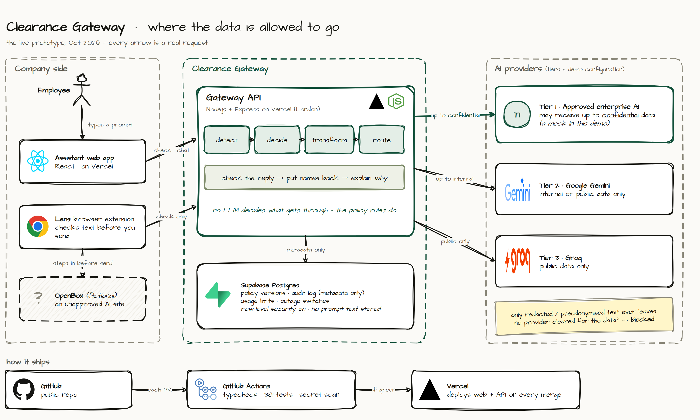
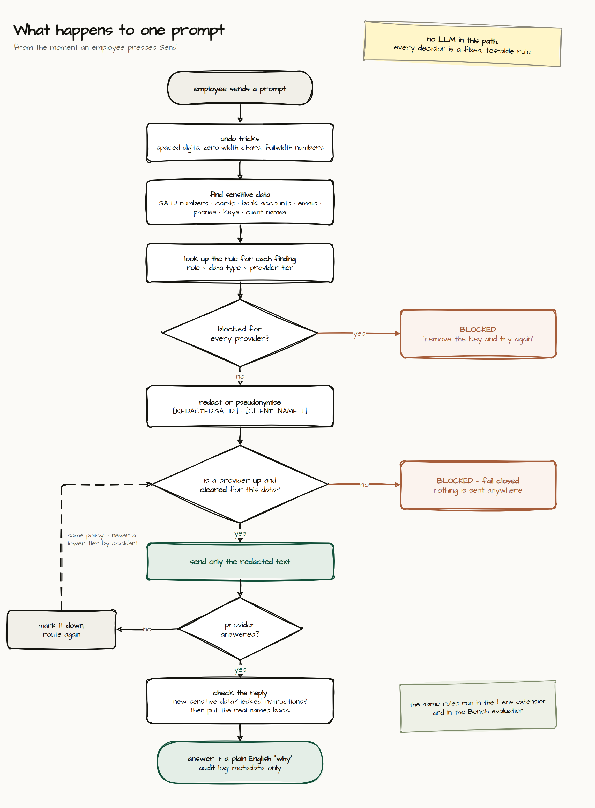

# Clearance Gateway

**Data only goes where it's cleared to go.**

[](https://github.com/shibambocollins/clearance-gateway/actions/workflows/ci.yml)

**Repository:** https://github.com/shibambocollins/clearance-gateway  
**Live prototype:** https://shibambocollins.github.io/clearance-gateway/

A policy-enforcement gateway between employees and AI providers. An admin writes the company AI policy in plain English once. An LLM drafts it into rules, and a person reviews and activates them. After that, every prompt is checked by fixed rules: **no LLM decides what gets through.** Sensitive data is redacted or pseudonymised, and each prompt is routed only to a provider cleared to receive it. If none is, the request is blocked and explained (fail closed).

Detection, false alarms, evasion, policy correctness and failover safety are measured on a synthetic test set, not assumed. The results are below. Built for the Credify System Thinking Challenge 2026, area 01 (AI & Cybersecurity): *How can companies use AI without creating new security risks?*

## Try it

| | |
|---|---|
| App (GitHub Pages) | https://shibambocollins.github.io/clearance-gateway/ |
| App (Vercel, same build) | https://clearance-gateway-web.vercel.app |
| API (Vercel) | https://clearance-gateway-api.vercel.app/health |
| Browser extension (Lens) | [Latest release](https://github.com/shibambocollins/clearance-gateway/releases/latest) |
| Admin code | `credify-8d724294` (a shared code for judges, see limitations) |

## Why there is also a browser extension

A gateway only protects the route people choose to use. Employees do not paste into one approved tool: they paste into whatever AI site is open in the next tab. If the safe route is slower, or the habit is already formed, the policy is bypassed without anyone deciding to break it.

**Lens** closes that gap. It brings the same checks to the browser, so they apply where the data actually leaves, with no change in habit:

- **Quick check from the toolbar:** paste text, see what would be removed, copy the redacted version. Works on any page.
- **Right-click on selected text, anywhere:** choose *Check with Clearance Gateway*.
- **Protect this site:** switch it on for one site and Lens checks what you send there, stepping in only when something sensitive is found.

It is opt-in and private by design. Lens reads nothing unless you protect a site or select text yourself, and sends only the text to be checked to the same API and the same policy as the web app. If a check fails, the message is held back.

The demo target is **OpenBox**, a fictional unapproved AI site (it calls no AI and imitates no real product). Install steps are [below](#lens-browser-extension).

## What it looks like







More screenshots (reply and "Why", dashboard, policy decision diff) are in [`docs/screenshots/`](docs/screenshots/).

## 2-minute judge path

1. Open the **app**. You land on the employee **Assistant**.
2. Click the **ID number** sample.
   - The ID number is highlighted, and **What will be sent** shows `[REDACTED:SA_ID]`.
   - Click **Send**. Under **Why**: *"Removed 1 South African ID number. Rule R-PII-01: ID numbers may not be sent to AI providers."*
3. Open **Simulate a provider outage** at the bottom, enter the admin code, and click **Simulate outage** next to *Approved enterprise AI*.
4. Click **Send** again. *"Blocked: no approved provider is available for confidential data right now (fail closed, rule R-ROUTE-01)."* The data is not sent to a lower-tier provider.
   - Optional: click the **Clean** sample and send it. It fails over to a real model (Google Gemini), because public data is cleared for tier 2.
5. Open **Evaluation** for the measured results against two baselines.
6. Click **Reset (seed policy, no outages)** (outages also switch off by themselves after 10 minutes).

More to try:
- **API key** sample: blocked, with coaching.
- **Client name** sample: pseudonymised before sending, restored in the reply.
- **HR case** sample, with the role set to HR: shows the policy's role exceptions.
- **Policy** page: compile the policy text and review the decision diff.
- **Dashboard**: what the gateway did, built from audit metadata.

## Measured results

From [`eval/results/results.md`](eval/results/results.md): 195 synthetic test prompts, template-disjoint from the dev set, seed `20261029`. **Detection is not 100%.**

| | No gateway | Regex-only | Clearance Gateway |
|---|---|---|---|
| Precision | n/a | 55.6% | 100.0% |
| Recall | 0% | 59.5% | 92.9% |
| Evasion attempts caught | 0/54 | 3/54 | 45/54 |
| Look-alike "trap" prompts flagged | 0% | 64.4% | 0% |
| Sensitive values reaching a provider unprotected (of 126) | 126 | 48 | 9 |

- **Failover, with tier 1 down:** a naive "try the next provider" chain sends 87 of 87 confidential requests to a lower tier. The Clearance Gateway router makes **0 routing errors** and blocks 81. Six still went through because their data was never detected (ID numbers written as words, keys split across lines). Routing can only be as good as detection.
- **Policy matrix:** 96 of 96 role × data class × tier decisions correct.
- **Compiler check** (seed text, 3 runs): 3 of 3 valid, **0 decisions looser** than the hand-written policy, 35 stricter. See [`docs/evaluation.md`](docs/evaluation.md).

## How it works





**Every prompt** (no LLM in this path):
1. **Canonicalise:** undo evasion tricks (spaced digits, zero-width characters, fullwidth numbers).
2. **Detect** SA ID numbers, cards, bank accounts, emails, phone numbers, credentials and client or project names.
3. **Decide:** the strictest rule for each finding, by role and provider tier.
4. **Redact or pseudonymise**, or **block**.
5. **Route** to the first provider that is enabled, healthy and cleared for the data. None eligible: block (fail closed).
6. **Check the reply:** remove new sensitive data and leaked instructions, then restore pseudonyms.
7. **Explain** to the employee what happened and why. The audit record holds metadata only.

**Every policy change:**
1. The admin writes the policy in plain English.
2. An LLM compiler drafts rules, validated against a strict schema.
3. The admin reviews the decision diff (looser changes flagged) and tries it in the simulator.
4. A policy floor refuses anything looser than the baseline.
5. The admin activates it, and it is live within seconds.

The parts are the **Compiler** (policy text to rules), the **Engine** (`packages/core`, pure TypeScript with no I/O), the **Router** (clearance-based, fail closed) and the **Bench** (the evaluation harness). Details: [`docs/architecture.md`](docs/architecture.md).

## Features

- Plain-English policy compiled into reviewable, versioned rules
- Detection of South African ID numbers (date and check digit), cards, bank accounts, emails, phone numbers, credentials and named clients or projects
- Role-aware actions: allow, redact, pseudonymise or block
- Routing by provider trust tier, with fail-closed behaviour and re-routing under the same policy when a provider fails
- Output guard and pseudonym restore
- Plain-English explanations and coaching for every blocked or changed prompt
- Audit log with metadata only, and a dashboard built from it
- Simulator and decision diff for every policy change, plus a policy floor
- Evaluation harness (Bench) with a template-disjoint test split and two baselines
- Browser extension (Lens)

## Technology

- **Runtime:** Node 22 and TypeScript (strict), npm workspaces
- **API:** Express 5 on Vercel
- **Web:** React 19, Vite 8, React Router, Recharts, on Vercel
- **Database:** Supabase Postgres, with RLS on and no policies, so only the API's service role can read or write
- **Validation and tests:** zod and Vitest (381 tests)
- **Providers:** Gemini and Groq through plain `fetch`, plus a deterministic mock
- **CI:** GitHub Actions running typecheck, tests, build and a gitleaks secrets scan

## Run locally

```bash
npm install
cp .env.example .env     # everything is optional for a first run
npm run dev              # API http://localhost:3001 · web http://localhost:5173
npm test                 # Vitest across all workspaces
npm run eval             # regenerate the synthetic dataset and eval/results/*
```

- **Offline mode:** set `OFFLINE_MODE=true`. Every provider is answered by a deterministic mock, labelled in the UI. Routing, outages and fail-closed behaviour work as normal.
- **Without Supabase:** the API runs with the seed policy in memory and says so in `/health`.
- **Database setup:** apply [`supabase/schema.sql`](supabase/schema.sql) in the Supabase SQL editor, then run `npm run db:seed -w @clearance-gateway/api` to store the seed policy as version 1.
- **Compiler check:** `npm run compiler-check -w @clearance-gateway/api` re-runs it (needs API keys).

## Environment variables

| Variable | Used by | Purpose |
|---|---|---|
| `SUPABASE_URL`, `SUPABASE_SERVICE_ROLE_KEY` | API only | Policy versions, audit events, usage counters, simulated outages. Never in the web app. |
| `GEMINI_API_KEY`, `GEMINI_MODEL` | API | Tier-2 provider and the policy compiler (default model `gemini-3.5-flash-lite`) |
| `GROQ_API_KEY`, `GROQ_MODEL` | API | Tier-3 provider and compiler fallback (default model `openai/gpt-oss-20b`) |
| `OFFLINE_MODE` | API | `true` = mock provider only |
| `DEMO_ADMIN_CODE` | API | Required for admin endpoints (`x-admin-code` header) |
| `RATE_LIMIT_PER_CLIENT_PER_DAY`, `GLOBAL_DAILY_CAP` | API | Over the limit, replies come from the mock provider |
| `CLIENT_HASH_SALT` | API | Salt for hashing client IPs (raw IPs are never stored) |
| `CORS_ORIGINS` | API | Allowed web origins (comma-separated) |
| `POLICY_FLOOR` | API | `off` disables the policy floor (on by default) |
| `VITE_API_URL` | Web | API base URL |

## Lens browser extension

**Install (Chrome or Edge, "Load unpacked"):**
1. Download `clearance-gateway-lens.zip` from the [latest release](https://github.com/shibambocollins/clearance-gateway/releases/latest) and unzip it, or use the repo's `extension/` folder.
2. Open `chrome://extensions`, switch on **Developer mode**, click **Load unpacked**, and pick the unzipped folder. Pin the Lens icon.

**Four ways to use it:**
1. **Demo page:** open [/demo-chat](https://clearance-gateway-web.vercel.app/demo-chat) (**OpenBox**, fictional).
   - Paste the Assistant's **ID number** sample and press **Send**.
   - The overlay lists the finding and the redacted text. Click **Send redacted**, and OpenBox shows exactly what it received.
   - The **API key** sample is blocked, with no way to send it.
2. **Quick check (any page):** click the Lens icon, paste text into **Quick check**, then **Check**. You get the findings and **Copy redacted text**.
3. **Right-click (any page):** select text, right-click, and choose **Check with Clearance Gateway**.
4. **Protect a site you choose:** click the Lens icon, then **Protect this site**. Chrome asks permission for that site only. Lens then checks what you type there shortly after you stop, and steps in on Enter or Send only if something sensitive is found, offering **Replace with redacted text**, **Copy redacted text** or **Edit**. **Stop protecting** removes the permission.

**Privacy and safety:**
- Lens never reads pages unless you protect that site or select text yourself.
- Pages and the popup send only `{text, role}` to Lens's background worker, which calls the fixed Clearance Gateway API URL. Nothing is stored.
- If a check fails, the message is held back (fail closed).

**Not in the Chrome Web Store:** publishing needs a developer account and a review that takes days. Store listing and enterprise force-install are the path to production.

## Known limitations

The full list is in [`docs/limitations.md`](docs/limitations.md). In short:
- **Detection** is pattern- and dictionary-based. It has no contextual understanding, and some evasions are missed (measured above).
- **Routing** can only be as good as detection.
- **Out of scope:** coding agents (the design is documented, not built), SaaS copilots and TLS interception.
- **Shortcuts:** admin access is a single shared code, not SSO. Provider health is tracked per serverless instance. Provider tiers are demo configuration, not claims about any vendor's data handling.
- **Evidence:** all data is synthetic, and there has been no pilot with real employees.
- **Compiler:** an LLM. It can misread ambiguous wording (seen: stricter, never looser), which is why every compile is a reviewed draft.
- **Lens** works in Chromium browsers only, and its support for other sites is heuristic. It was only exercised end to end on the OpenBox page.

## Security and privacy

- No prompt or reply text is logged or stored. Audit events hold metadata only (`apps/api/src/audit.ts`), and finding previews are masked (`8001••••••087`).
- Token maps for pseudonyms live only for the duration of a request.
- The Supabase service-role key exists only in the API's environment. RLS is enabled with no policies, and database functions are executable by the service role only.
- A policy floor stops anyone activating a policy looser than the baseline, even with the public admin code. Compiles have a daily budget.
- 16 KB body limit, CORS allowlist, per-visitor and global daily limits. Errors never echo input. Security headers on both apps.
- gitleaks runs on every pull request and push to `main`. The review and threat model are in [`docs/security.md`](docs/security.md).

## AI-use disclosure

- **Most of the code was written by Claude Code** (Anthropic), including the tests and the technical documentation.
- **Most architectural decisions were taken by Collins.**
- **Claude** (Anthropic, in chat) was used as a research and writing assistant for the analysis documents (`docs/system-map.md`, `docs/intervention.md`) and the evaluation interpretation.
- At runtime, Google Gemini and Groq serve as providers and as the policy compiler.

## Documentation

- [`docs/system-map.md`](docs/system-map.md): problem, stakeholders, root causes, system relationships
- [`docs/intervention.md`](docs/intervention.md): options considered, why this one, feasibility, risks, impact
- [`docs/architecture.md`](docs/architecture.md): how the parts fit together
- [`docs/evaluation.md`](docs/evaluation.md): method and results
- [`docs/security.md`](docs/security.md): security review and threat model
- [`docs/limitations.md`](docs/limitations.md): known limitations
- [`docs/decisions.md`](docs/decisions.md): the decision log
- [`docs/diagrams/`](docs/diagrams/): architecture, flow and lifecycle diagrams, editable in draw.io
- [`docs/SPEC.md`](docs/SPEC.md): the specification
